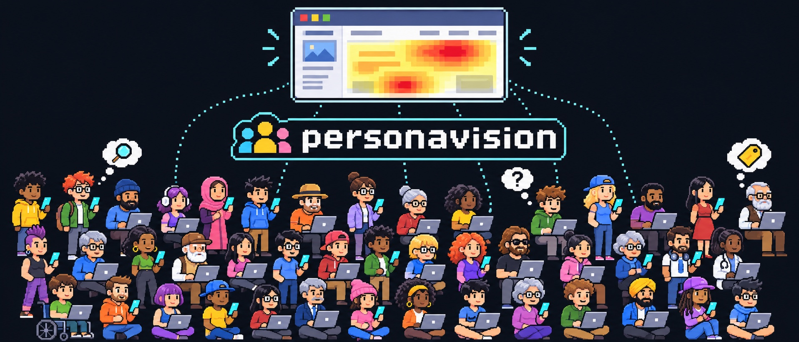
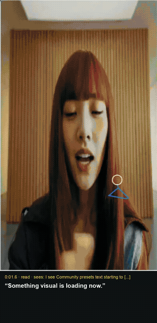
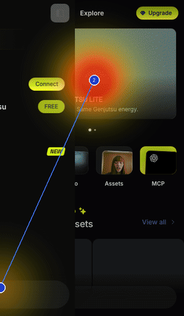
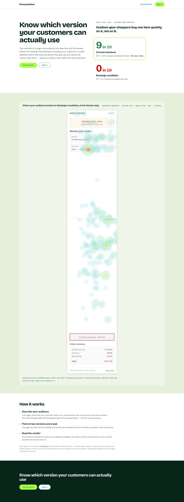
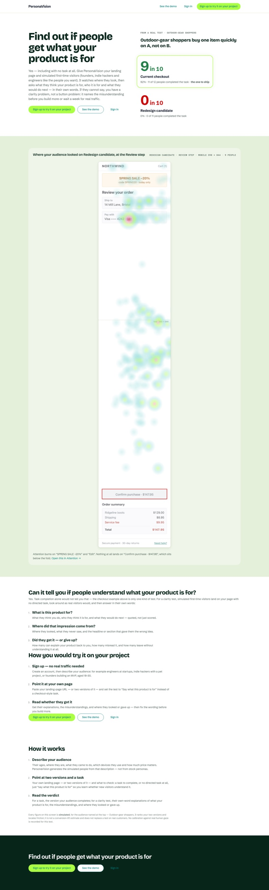

<p align="center">
  
</p>

<h1 align="center">PersonaVision</h1>

<p align="center">
  <b>Test your website with a crowd of AI people before real users ever see it.</b><br>
  Describe your audience. Watch them use your site on phone and desktop. See where they look, where they get lost and why, then let the AI fix it.
</p>

<p align="center">
  <a href="https://github.com/DiasKhalniyasov/personavision/actions/workflows/ci.yml"></a>
  
  
  
  <a href="https://github.com/DiasKhalniyasov/personavision/pulls"></a>
</p>

<p align="center">
  <a href="#quickstart">Quickstart</a> ·
  <a href="#how-it-works">How it works</a> ·
  <a href="#improve-your-site">Improve your site</a> ·
  <a href="#grounded-in-real-eyes">Eye tracker</a> ·
  <a href="docs/case-studies/front-page.md">Case study</a> ·
  <a href="#documentation">Docs</a>
</p>

---

## Why

A/B tests need real traffic, real customers and a week. Usability studies need recruiting. Most teams ship the change and hope.

PersonaVision gives you the answer before the meeting. It generates the people you are building for, sends each one through your site in a real browser, and records what they looked at, what they thought, what they clicked and where they gave up.

<p align="center">
  
  &nbsp;
  
</p>
<p align="center"><sub>A real person, recorded with the local eye tracker. The agents' trajectories and heatmaps take the same form.</sub></p>

## Features

- **🧑‍🤝‍🧑 Audiences from a sentence.** "Backend developers evaluating a scraping API, mostly on desktop" becomes a crowd of distinct people, each with their own age, role, device, patience and confidence.
- **🌐 Real browsers, mobile and desktop.** Every person drives a real Chromium through your live site. Muse Spark reads each screen and decides the next move, with a reason.
- **🔥 Heatmaps, attention and paths.** Where each person looked, in order, what they clicked, and where the audience dropped out, aggregated across everyone.
- **💬 Their thoughts, step by step.** Every move comes with the sentence behind it, so a drop-off has a reason and not just a number.
- **🧠 Recommendations that cite evidence.** Muse Wonder reads the sessions and says what to change, linking each claim to the moment in a recording that shows it.
- **🛠️ It fixes the site, too.** Point it at your repository and Wonder edits the code turn by turn, checks the build, reruns the same people on the change and opens a pull request. It never merges.
- **👁️ Grounded in real eyes.** A webcam eye tracker you run locally records real people, to teach and measure the agents.

## How it works

```
 describe your users ──▶ a generated audience ──▶ each person tries your site ──▶ trajectories & heatmaps ──▶ Wonder's fixes
   "18–30 engineers        ages, roles,             real Chromium, phone            where they looked,          a recommendation per
    building startups"     devices, patience        and desktop, Muse Spark         clicked, gave up, and why   problem, or a pull request
```

1. **Describe who your users are.** PersonaVision generates the audience from it.
2. **Each person tries your site** with a goal you set in plain words, such as "find out what this costs". Success is something visible: a URL, an element or a piece of text.
3. **Every session leaves a trajectory:** a recording, the gaze path, the clicks and the reasoning. Across the audience these add up to heatmaps, paths and a funnel.
4. **Muse Wonder reads the results** and tells you what to change, citing the moment in a session that shows it.

## Case study: it fixed its own front page

Five generated software engineers tried PersonaVision's front page. **None of them** found how to try it: "it only checks task completion, not if people get what it's for". Wonder read their sessions, rewrote the page in 16 checked steps and opened a pull request. On the new page, **three of the same five** reached sign-up.

| Before                                                                                                    | After                                                                                                   |
| --------------------------------------------------------------------------------------------------------- | ------------------------------------------------------------------------------------------------------- |
|  |  |

[Read the case study →](docs/case-studies/front-page.md)

## Quickstart

You need Node 22, pnpm and, for model runs, a `MODEL_API_KEY` for the Meta Model API (Muse Spark and Muse Wonder).

```sh
git clone https://github.com/DiasKhalniyasov/personavision && cd personavision
corepack enable && pnpm install
pnpm build
pnpm --filter @personavision/browser exec playwright install chromium

pnpm open      # explore the committed example run, offline, at http://127.0.0.1:5175/
```

**Test your own site** with five generated people:

```sh
export MODEL_API_KEY=...
node packages/cli/dist/cli.js run \
  --site https://your-site.com \
  --feature "finding the pricing" \
  --task "Find out how much the product costs per month" \
  --criterion "The address bar reads /pricing." \
  --audience outdoor-gear-shoppers --repeats 1 --engine model

pnpm open      # the run you just made, with replays, heatmaps and every person's thoughts
```

`--audience` takes a preset name or a JSON file describing your people; [`docs/improve-local.md`](docs/improve-local.md) has a full example.

**The whole product, with sign-in and the New test flow:**

```sh
MODEL_API_KEY=... node packages/cli/dist/cli.js serve   # prints a one-time demo password on first start
```

## Improve your site

`pnpm improve:local` closes the loop on a repository on your own machine. There is no GitHub App and no hosting.

```sh
pnpm improve:local runs/<run id> \
  --repo ~/code/my-site \
  --file src/pages/index.tsx --file src/pages/index.test.tsx \
  --check "pnpm build && pnpm test" \
  --serve "pnpm start --port {port}" \
  --pr
```

1. Wonder writes the recommendations for the run.
2. Wonder edits only the files you allow, one action per turn, on a new branch. Every turn it rereads the whole conversation: the test, each person's thoughts and actions, and the result of each earlier step. After every change your `--check` runs, and its result is the next thing Wonder reads.
3. The same people, on the same seed, take the same test on the changed site.
4. A pull request opens with the change, the reasons and the before and after.

The full guide is [`docs/improve-local.md`](docs/improve-local.md).

## Grounded in real eyes

[`tools/eyetrack`](tools/eyetrack) is a webcam eye tracker that runs on your machine. Record real people browsing a site, on desktop or phone, and get heatmaps, gaze paths and a report. Those recordings become the gaze examples a run is shown (`--gaze-examples`), and the data to fit small models of how real people read a page. [`packages/calibration`](packages/calibration) scores the agents against human eye-tracking data.

```sh
node tools/eyetrack/track.mjs https://example.com --mobile
```

## Architecture

A pnpm monorepo in strict TypeScript. Every run is a directory of plain JSON files and recordings, validated against one contract.

| Package                               | What it does                                                                    |
| ------------------------------------- | ------------------------------------------------------------------------------- |
| [`contract`](packages/contract)       | The run artifact's schemas, and the reader and writer every other package uses  |
| [`personas`](packages/personas)       | Generates people from an audience description                                   |
| [`browser`](packages/browser)         | Drives Chromium, captures screens, areas of interest and video                  |
| [`engine`](packages/engine)           | Gaze, fixations and the behaviour model of one session                          |
| [`swarm`](packages/swarm)             | Runs the audience: concurrency, seeds and the runner                            |
| [`provider`](packages/provider)       | Muse Spark's decisions and Muse Wonder's audiences, goals, analysis and changes |
| [`scoring`](packages/scoring)         | Funnels, heatmaps, findings and recommendations                                 |
| [`improve`](packages/improve)         | The pull-request loop for a connected repository                                |
| [`platform`](packages/platform)       | Accounts, workspaces, sites and the HTTP API behind the app                     |
| [`calibration`](packages/calibration) | Scores the agents against human eye tracking                                    |
| [`cli`](packages/cli)                 | `personavision run`, `serve`, `open`, `validate`, `aggregate`, `improve`        |
| [`apps/viewer`](apps/viewer)          | The web app: onboarding, New test, Running, results and replays                 |

## Development

```sh
pnpm typecheck   # builds every package, then type-checks tests and scripts
pnpm lint
pnpm test        # no network call and no credential
pnpm build
pnpm validate:example-run
```

CI runs the same sequence on Node 22 with a frozen lockfile. [`tests/cold-start.test.ts`](tests/cold-start.test.ts) checks that a fresh clone starts the app on the committed example run.

| Script                         | What it does                                                                                                                           |
| ------------------------------ | -------------------------------------------------------------------------------------------------------------------------------------- |
| `pnpm open`                    | The app on the most recent run, at http://127.0.0.1:5175/                                                                              |
| `pnpm dev`                     | Vite dev server for `apps/viewer`                                                                                                      |
| `pnpm demo:run`                | Regenerates the demo shop's run                                                                                                        |
| `pnpm recommend:run <run dir>` | Writes a run's recommendations                                                                                                         |
| `pnpm improve:local <run dir>` | Wonder improves a site from a run and opens a pull request                                                                             |
| `pnpm bake:landing-slides`     | Bakes the front page carousel's slides from committed runs                                                                             |
| `pnpm acceptance:templates`    | Runs every example template against its live site — needs a model key, spends money, never in CI ([docs](docs/template-acceptance.md)) |
| `pnpm format`                  | Prettier, in place; `pnpm format:check` only reports                                                                                   |

The front page carousel's slide data is generated from committed runs and never edited by hand; `slides.test.ts` reruns this exact line and compares the bytes:

```
pnpm bake:landing-slides runs apps/viewer/src/screens/landing/slides.json 2026-10-24-1402-northwind-demo:S-03:2 2026-10-24-1402-northwind-demo:S-09:1 2026-10-24-1402-northwind-demo:S-04:24 2026-10-24-1402-northwind-demo:S-13:4 2026-10-24-1402-northwind-demo:S-24:3
```

## Documentation

- [`CONTEXT.md`](CONTEXT.md): the module map and the artifact's field names
- [`docs/FLOW.md`](docs/FLOW.md): the product flow, end to end
- [`docs/improve-local.md`](docs/improve-local.md): improve a site from a test, on your own repository
- [`docs/case-studies/front-page.md`](docs/case-studies/front-page.md): PersonaVision improving its own front page
- [`docs/demo.md`](docs/demo.md): the demo, beat by beat
- [`docs/template-acceptance.md`](docs/template-acceptance.md): the example templates run against their live sites, by hand
- [`docs/meta-model-api.md`](docs/meta-model-api.md): how Muse Spark and Muse Wonder are called
- [`docs/adr/`](docs/adr): the decisions, with the alternatives that were rejected

## Contributing

Issues and pull requests are welcome. Run `pnpm typecheck && pnpm lint && pnpm test` before you open one; CI runs the same.

<p align="center"><sub>Every figure PersonaVision shows is simulated. It ranks versions and finds friction before real traffic does; it does not replace a test on real customers.</sub></p>
