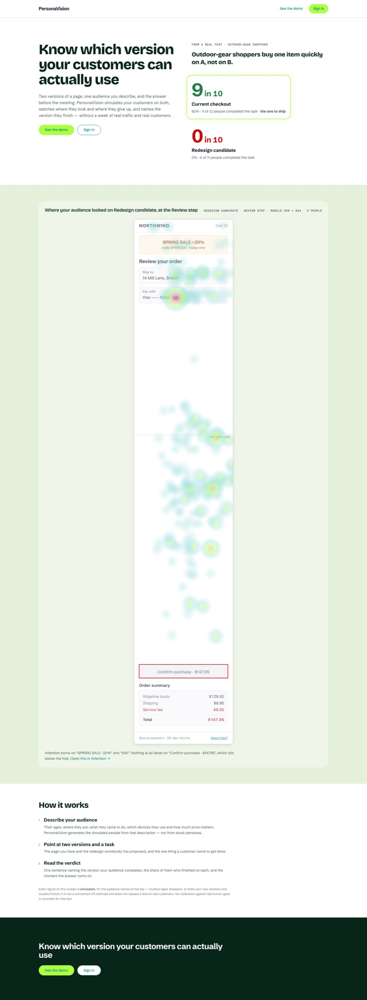
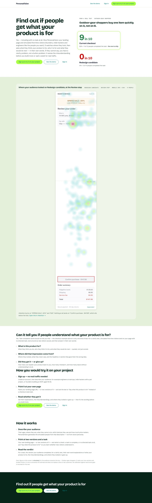
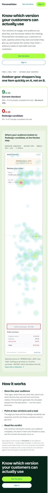
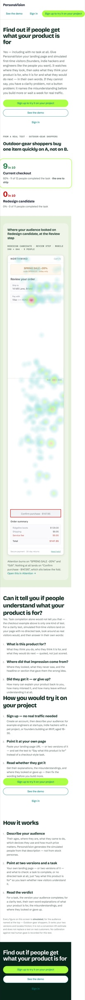

# Case study: PersonaVision improves its own front page

Five generated software engineers tried PersonaVision's front page, and none of them found how to try it. Muse Wonder read what they did and thought, changed the page in 16 steps, and opened a pull request. On the new page, three of the same five people reached sign-up.

Everything below ran locally, with [`pnpm improve:local`](../improve-local.md).

## The test

|              |                                                                                                                                              |
| ------------ | -------------------------------------------------------------------------------------------------------------------------------------------- |
| **Site**     | PersonaVision's front page, served locally                                                                                                   |
| **Audience** | 5 software engineers aged 18–30, at startups, on pet projects or building an MVP; 3 on desktop, 2 on mobile                                  |
| **Task**     | "Find out whether PersonaVision could tell you if people understand what your own product is for, and how you would try it on your project" |
| **Success**  | The address bar reads `/signup`                                                                                                              |

## Before: 0 of 5

Every person read the page as a tool for checkout funnels, and gave up.

> "it only checks task completion not if people get what it's for, and trying it means signing in which I can't do, so I'm out" (S-05, desktop)

> "I've scrolled past checkout completion and heatmaps but see nothing about whether people understand what a product is for, so I'm giving up" (S-01, iPhone)

## What Wonder did

Muse Wonder got the test, every person's thoughts and actions, and three files it was allowed to change. Each turn it saw the whole conversation so far and took one action. After every change the build and the page's tests ran, and it read the result.

1. It read the page, its tests and its styles.
2. It rewrote the headline: "Find out if people get what your product is for".
3. It updated the test that asserted the old headline, because the check failed.
4. It made "Sign up to try it on your project" the primary action, in the header, the hero and the closing band.
5. It added two sections, "Can it tell you if people understand what your product is for?" and "How you would try it on your project", and rewrote the steps.
6. It added tests that every sign-up button leads to `/signup`, then finished with the build and the tests green.

The result was [pull request #434](https://github.com/DiasKhalniyasov/personavision/pull/434): +81 −11 in two files.

| Before                                                                                                                                       | After                                                                                                                                      |
| -------------------------------------------------------------------------------------------------------------------------------------------- | ------------------------------------------------------------------------------------------------------------------------------------------ |
|  |  |

| Before, mobile                                                                                 | After, mobile                                                                                |
| ---------------------------------------------------------------------------------------------- | -------------------------------------------------------------------------------------------- |
|  |  |

## After: 3 of 5 reached sign-up

The same five people, with the same seed, ran on the merged page.

|                           | Before                                 | After                                                           |
| ------------------------- | -------------------------------------- | --------------------------------------------------------------- |
| Understood what it is for | none: "it only checks task completion" | all five: "it tests whether people get what my product is for" |
| Reached sign-up           | 0 of 5                                 | 3 of 5                                                          |

The run itself counted one success. Two sessions reached the sign-up page through a client-side link, and the URL check missed them: their next thought quotes text that only the sign-up page shows. That is a bug in the check, and it is being fixed.

## What they still ran into

- **The checkout example sits in the way.** Three people scrolled past the long heatmap four to six times before they reached "How you would try it": "this endless heatmap".
- **The demo page ends at sign-in.** One person opened the demo's findings and hit a sign-in. Another clicked "Sign in to run this on your own pages", had no account, and left.
- **Creating an account is still a step.** One person reached sign-up and stopped there.

Each of these is the next `improve:local` run.

## Run it yourself

The commands are in [`docs/improve-local.md`](../improve-local.md#example-personavisions-own-front-page). The run directories were `runs/2026-11-04-1901-find-out-whether-personavision-could-tell` (before) and `runs/2026-11-04-2007-find-out-whether-personavision-could-tell` (after); run directories are local and not committed.
