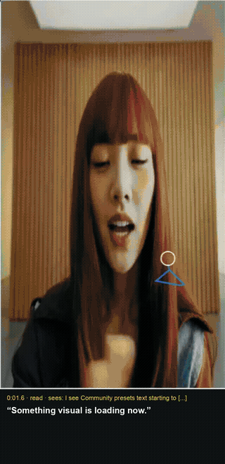
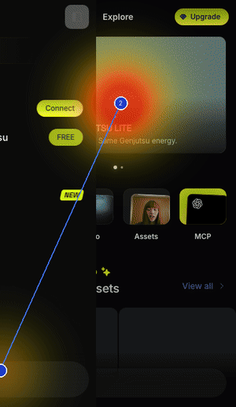

# Eye tracker

Webcam eye tracking on any website, run locally. Records where real people look, as heatmaps, gaze paths and a report, to teach PersonaVision's agents how people actually read a page.

<p>
  
  
</p>

_Left: live gaze with the person's own words. Right: where they looked, in order._

## Run

```sh
pnpm install && pnpm --filter @personavision/browser exec playwright install chromium
python3.11 -m venv tools/eyetrack/ptgaze/.venv
tools/eyetrack/ptgaze/.venv/bin/pip install -r tools/eyetrack/requirements.txt

node tools/eyetrack/track.mjs https://example.com            # desktop
node tools/eyetrack/track.mjs https://example.com --mobile   # phone
```

Calibrate, browse, close the window. Output: `tools/eyetrack/sessions/<time>/`.

## Use the data

- `narrate.py <session>` writes `gaze-example.txt` for `personavision run --gaze-examples` (needs `MODEL_API_KEY`).
- `report.py` and `video.py` rebuild the report and a gaze-overlay video.

Nothing leaves your machine. `sessions/` is git-ignored; record others only with consent.
